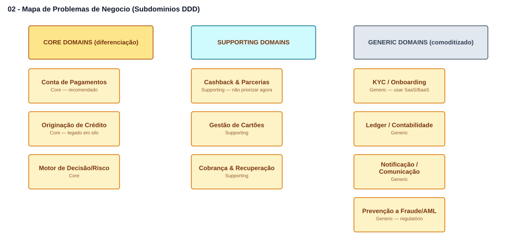
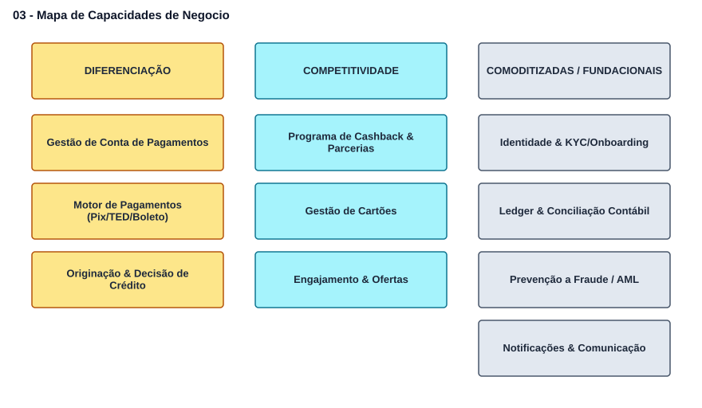
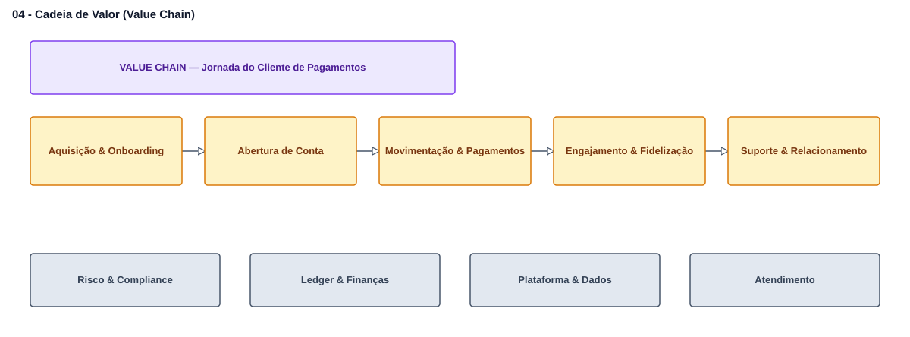
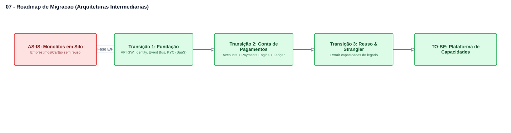
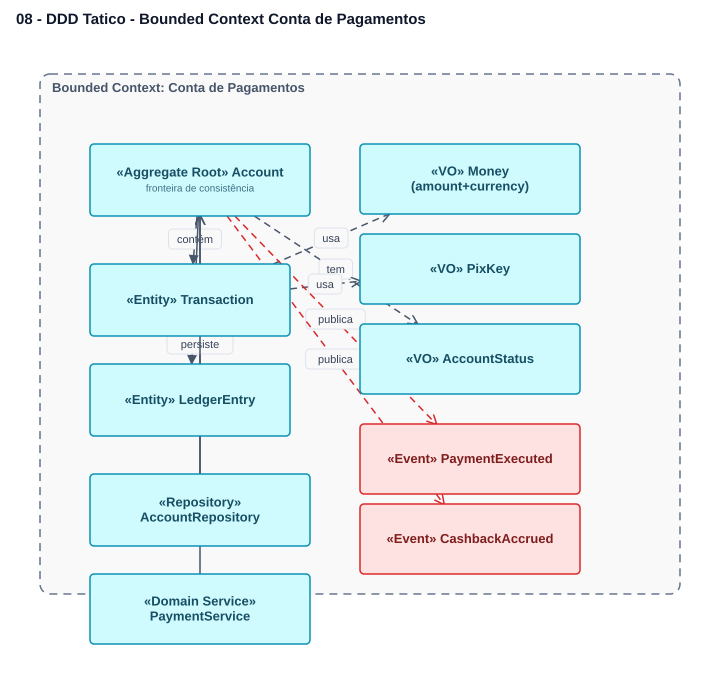

# 🏦 Case Enterprise Architecture — Banco SP

Resolução completa de um **case de Enterprise Architecture** para um banco em São Paulo que precisa aumentar engajamento e acelerar o lançamento de novos produtos. A entrega é uma **Visão de Arquitetura (TOGAF ADM — Fase A)** com recomendação de produto, decisão sobre Core Bancário e plano de migração, modelada com **ArchiMate**, **C4 Model** e **DDD**.


> 📄 Documento executivo: **[VISAO-DE-ARQUITETURA.md](./VISAO-DE-ARQUITETURA.md)** · ✅ Rastreabilidade: **[RASTREABILIDADE.md](./RASTREABILIDADE.md)** (100% dos requisitos do desafio atendidos)

---

## 🎯 O desafio em uma frase

O C-Level quer priorizar **um** produto (Conta de Pagamentos **ou** Cashback), decidir se adquire uma plataforma de **Core Bancário**, e acelerar lançamentos — tudo **sem abandonar o estilo Microservices** e sabendo que o legado está em **silos** que travam a cadeia de valor.

## ✅ Recomendação do Enterprise Architect

| Pergunta | Recomendação | Lastro resumido |
|---|---|---|
| Conta de Pagamentos **ou** Cashback? | **Conta de Pagamentos** | Core domain transacional; o Cashback depende de uma conta para pontuar/resgatar. |
| Adquirir Core Bancário? | **Não comprar core fechado; compor capacidades** | Core caixa-preta reintroduz o acoplamento/silo que queremos eliminar. Comprar só nos *generic domains* (KYC, Ledger, antifraude). |
| Como acelerar lançamentos? | **Plataforma de capacidades reutilizáveis + Strangler Fig** | Capacidades compartilhadas viram *building blocks*; legado migra sem big-bang. |

## 🖼️ Visualizador standalone

Este repositório inclui um **visualizador próprio** (HTML + JS puro, sem build) para abrir os diagramas sem depender de nenhuma outra ferramenta.

```bash
# qualquer servidor estático serve; exemplo com npx:
npm run serve
# abra o endereço exibido (ex.: http://localhost:3000) no navegador
```

> Observação: abrir o `index.html` com duplo-clique (`file://`) pode bloquear o `fetch` dos JSON por política do navegador. Use um servidor estático (`npm run serve`, `python -m http.server`, a extensão *Live Server* do VS Code, etc.).

No visualizador dá para navegar entre os 7 diagramas e baixar cada um como **SVG**.

## 🖼️ Arquiteturas (prints)

Imagens geradas a partir dos diagramas (`images/*.svg`). Para editar/exportar, importe os `.eas.json` no [Enterprise Architecture Studio](https://github.com/edsinfobr/enterprise-architecture-studio).

### 01 · Visão de Arquitetura (TOGAF Fase A)


### 02 · Mapa de Problemas de Negócio — Subdomínios (DDD)


### 03 · Mapa de Capacidades de Negócio


### 04 · Cadeia de Valor (Value Chain)


### 05 · Value Stream — Realizar um Pagamento


### 06 · Arquitetura Alvo TO-BE (Microservices · C4)


### 07 · Roadmap de Migração (Arquiteturas Intermediárias)


### 08 · DDD Tático — Bounded Context "Conta de Pagamentos"


## 📐 Artefatos (pasta `diagrams/`)

| # | Artefato | Framework | Responde ao item do case |
|---|---|---|---|
| 01 | Visão de Arquitetura (TOGAF Fase A) | ArchiMate (Motivação) | Visão, requisitos, estilo Microservices |
| 02 | Mapa de Problemas de Negócio (Subdomínios DDD) | DDD estratégico | Core / Supporting / Generic + build-vs-buy |
| 03 | Mapa de Capacidades de Negócio | Business Capability Map | Classificação (diferenciação/competitividade/comoditizadas) |
| 04 | Cadeia de Valor (Value Chain) | Value Chain | Agrupamentos funcionais |
| 05 | Value Stream "Realizar um Pagamento" | Value Stream | Interoperabilidade de funcionalidades |
| 06 | Arquitetura Alvo TO-BE (Microservices) | C4 (Container) | Decomposição, building blocks, event-driven |
| 07 | Roadmap de Migração | TOGAF Fases E/F | Arquiteturas intermediárias (Strangler Fig) |
| 08 | DDD Tático — Bounded Context | DDD tático (C4 Component) | Aggregate, Entities, Value Objects, Domain Events, Repository |

Os diagramas estão no formato `.eas.json`, nativo do [Enterprise Architecture Studio](https://github.com/edsinfobr/enterprise-architecture-studio), onde podem ser **editados** e exportados em PNG/SVG/PDF. Regenere as imagens com `npm run render`.

## 🔁 Regenerar os diagramas

Os `.eas.json` são determinísticos e regeneráveis a partir do código em `scripts/`:

```bash
npm run generate
# recria diagrams/*.eas.json e diagrams/manifest.json
```

## 🧭 Decisões metodológicas (por que estes frameworks)

- **TOGAF ADM Fase A** — o case pede uma *Visão de Arquitetura* e um *plano de migração* (Fases E/F); o ADM organiza o ciclo.
- **DDD (estratégico e tático)** — classifica subdomínios para guiar build-vs-buy e define *bounded contexts = microservices*.
- **Business Capability Map / Value Stream** — linguagem de negócio neutra para priorizar investimento e expor o custo dos silos.
- **C4 + ArchiMate** — C4 para a solução (containers/microservices); ArchiMate para motivação, negócio e capacidades.

## 📁 Estrutura

```
case-arquiteto-banco/
├── index.html                 # Visualizador standalone
├── viewer.js                  # Renderizador SVG dos .eas.json (no navegador)
├── VISAO-DE-ARQUITETURA.md     # Documento executivo completo
├── images/                    # Prints SVG das 7 arquiteturas (exibidos acima)
├── diagrams/                  # 7 diagramas .eas.json + manifest.json
├── scripts/
│   ├── generate-case.mjs      # Gerador determinístico dos diagramas
│   └── render-svg.mjs         # Gera os PNG/SVG em images/
└── .github/workflows/         # CI: valida e checa sincronia do gerador
```

## 📄 Licença

MIT — veja [LICENSE](./LICENSE).
